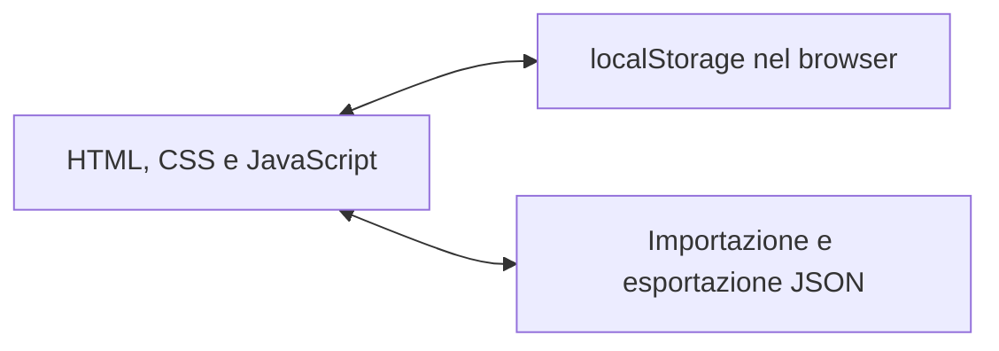
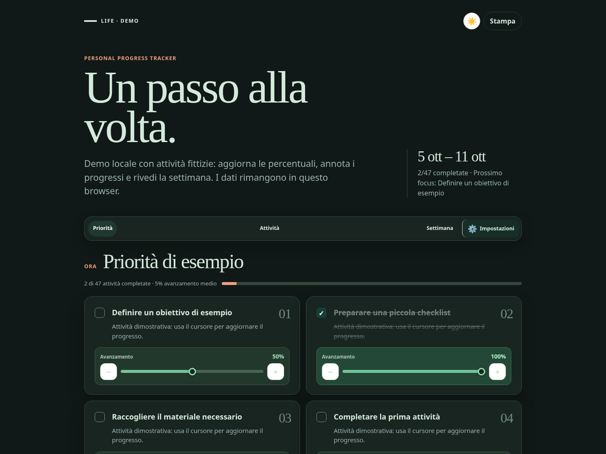
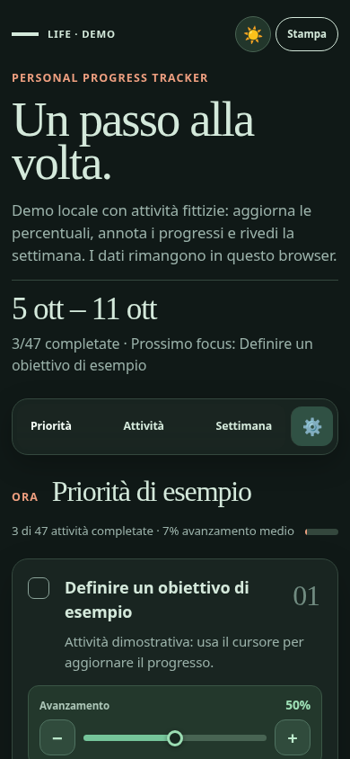

# Life — Personal Progress Tracker

[Italiano](#italiano) · [English](#english) · [Profilo](../README.md)

## Italiano

### Problema e contributo

Ho sviluppato Life per organizzare obiettivi personali e attività, annotare i progressi e vedere l'avanzamento nel tempo. È una web app personale che utilizzo su PC e iPhone.

**Frontend:** HTML, CSS e JavaScript.

**Versione personale cloud:** Cloudflare Pages, Workers e D1.

### Cosa contiene l'anteprima analizzata

- Attività organizzate per aree, con percentuali di avanzamento e stato di completamento.
- Note per gruppo e una sezione di revisione settimanale.
- Salvataggio locale nel browser con `localStorage`.
- Importazione ed esportazione dei dati in JSON.
- Temi grafici e interfaccia adattabile a schermi diversi.

### Anteprima e versione personale

L'anteprima fornita è un file HTML autonomo con sincronizzazione disattivata: non contiene il Worker, lo schema D1 o chiamate all'API cloud. Nella versione personale uso Cloudflare Pages, Workers e D1 per la sincronizzazione tra PC e iPhone; queste componenti non sono state verificate dai sorgenti dell'anteprima.

Ho preparato una demo locale con 47 attività fittizie, chiavi di salvataggio dedicate e importazione JSON validata. Credenziali, endpoint privati, esportazioni personali e contenuto del database restano esclusi.

Tre gruppi di prove nel browser Chromium hanno verificato progressi, note, persistenza, backup/importazione e temi, con viewport desktop e mobile. I file non validi vengono rifiutati senza sostituire i dati esistenti. La prova mobile è una simulazione a 390 pixel, non un test su iPhone fisico. La demo non è ancora pubblicata in un repository dedicato.

### Screenshot della demo

Schermate con attività e dati fittizi.

## English

### Problem and contribution

I developed Life to organise personal goals and tasks, record progress and track completion over time. It is a personal web app that I use on my PC and iPhone.

**Frontend:** HTML, CSS and JavaScript.

**Personal cloud version:** Cloudflare Pages, Workers and D1.

### Features in the reviewed preview

- Tasks grouped by area, with progress percentages and completion status.
- Group notes and a weekly review section.
- Local browser storage through `localStorage`.
- JSON data import and export.
- Visual themes and an interface that adapts to different screen sizes.

**Preview architecture:** HTML/CSS/JavaScript ↔ browser `localStorage`, with JSON import/export.

### Preview and personal version

The supplied preview is a standalone HTML file with synchronisation disabled. It contains no Worker, D1 schema or cloud API calls. In the personal version, I use Cloudflare Pages, Workers and D1 to synchronise between PC and iPhone; these components could not be verified from the preview source.

I prepared a local demo with 47 fictional tasks, dedicated storage keys and validated JSON imports. Credentials, private endpoints, personal exports and database content remain excluded.

Three Chromium browser verification groups checked progress, notes, persistence, backup/import and themes with desktop and mobile viewports. Invalid files are rejected without replacing existing data. The mobile check uses a simulated 390-pixel viewport, not a physical iPhone. The demo has not yet been published in a dedicated repository.

### Demo screenshots

The screenshots above show fictional activities and data, in desktop and mobile viewports.
