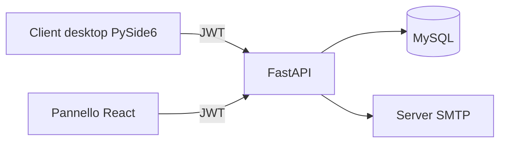

# maintenance-api

[Italiano](#italiano) · [English](#english)

## Italiano

### Problema e contributo

Ho sviluppato un progetto gestionale per organizzare clienti, manutenzioni e abbonamenti nel settore impiantistico. Nasce da un'esigenza di lavoro: aiutare gli operatori a gestire scadenze e promemoria per i clienti.

Il lavoro comprende lo sviluppo delle API e la gestione dei dati, un client desktop Python/PySide6 e un pannello web React dedicato agli abbonamenti.

### Componenti analizzati

| Componente | Tecnologie | Ruolo |
|---|---|---|
| Backend | Python, FastAPI, MySQL | API e gestione dei dati |
| Client desktop | Python, PySide6 | Interfaccia del gestionale |
| Pannello web | React, Vite, Axios | Interfaccia per gli abbonamenti |

Il backend integra autenticazione JWT, password con bcrypt, importazione Excel con openpyxl e invio email tramite SMTP.

**Stato dei sorgenti:** codice e dati aziendali riservati. Questa scheda pubblica presenta il progetto a livello generale; non richiede accesso al software aziendale.

### Ambiti del backend

- Gestione delle anagrafiche e delle scadenze di manutenzioni e abbonamenti.
- Registrazione dei pagamenti e importazione di dati da Excel.
- Accesso con autenticazione JWT e ruoli utente/amministratore.
- Invio di promemoria email e registro delle operazioni.

Gli endpoint email inviano i promemoria quando vengono chiamati dal gestionale. Il backend analizzato non include uno scheduler autonomo.

Nei sorgenti del client sono presenti anche notifiche desktop e script PowerShell per avvisi pianificati sul PC Windows. Gli avvisi sul PC sono distinti dall'invio delle email tramite API.

### Stato e verifiche

- **Verificato sulla copia di sviluppo:** test di regressione, integrazione del client HTTP desktop con API, MySQL e SMTP locali; compilazione e prove del pannello React con dati fittizi; avvio della finestra Qt su Linux.
- **Da completare:** collaudo su Windows del client, dell'installer e delle notifiche native. La copia di sviluppo resta separata dall'installazione aziendale.

### Riservatezza

I sorgenti e i dettagli operativi restano privati. La scheda non contiene credenziali, dati dei clienti o configurazioni dell'ambiente aziendale.

[Torna al profilo](../README.md)

---

## English

### Problem and contribution

I developed management software to organise customers, maintenance jobs and subscriptions for an electrical installation business. It addresses a workplace need: helping operators manage due dates and customer reminders.

The work covers API development and data handling, a Python/PySide6 desktop client and a React panel dedicated to subscriptions.

### Reviewed components

| Component | Technologies | Role |
|---|---|---|
| Backend | Python, FastAPI, MySQL | APIs and data handling |
| Desktop client | Python, PySide6 | Business application interface |
| Web panel | React, Vite, Axios | Subscription management interface |

The backend integrates JWT authentication, bcrypt password hashing, Excel imports through openpyxl and email delivery through SMTP.

**Source availability:** source code and company data remain private. This public case study provides a general overview of the project without requiring access to the business application.

### Backend scope

- Customer records and due dates for maintenance jobs and subscriptions.
- Payment recording and Excel data imports.
- JWT authentication and user/administrator roles.
- Email reminders and an operation audit log.

The email endpoints send reminders when called by the business application. The reviewed backend does not include a standalone scheduler.

The client source also contains desktop notifications and PowerShell scripts for scheduled alerts on a Windows PC. PC alerts are separate from email delivery through the API.

**Architecture:** PySide6 desktop client / React panel → FastAPI → MySQL and SMTP.

### Status and validation

- **Verified on the development copy:** regression tests; desktop HTTP client integration with a local API, MySQL and SMTP; React build and browser checks with synthetic data; Qt main window startup on Linux.
- **Still to complete:** Windows validation of the desktop client, installer and native notifications. The development copy remains separate from the company installation.

### Confidentiality

Source code and operational details remain private. This case study contains no credentials, customer data or business environment configuration.

[Back to the profile](../README_EN.md)
