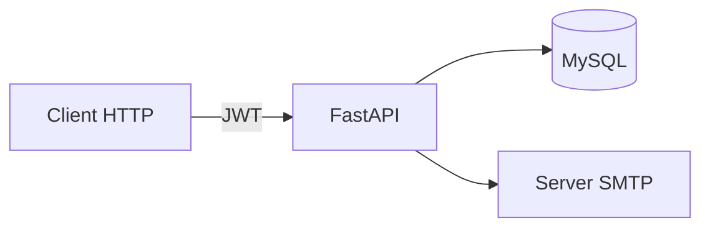

# maintenance-api

[Italiano](#italiano) · [English](#english) · [Profilo](../README.md)

## Italiano

### Problema e contributo

Backend per organizzare clienti, manutenzioni e abbonamenti nel settore impiantistico. Gli operatori registrano scadenze e inviano promemoria ai clienti.

**Tecnologie:** Python, FastAPI, MySQL, JWT, bcrypt, openpyxl, SMTP.

**Repository:** [MatteBianca/maintenance-api](https://github.com/MatteBianca/maintenance-api) (privato — sorgenti senza dati aziendali).

### Funzionalità

- Clienti: creazione, lettura, modifica, eliminazione
- Manutenzioni: scadenze, filtri, stato di completamento
- Abbonamenti: scadenze, registrazione pagamenti, import Excel
- Login JWT, password con bcrypt, ruoli utente/admin
- Promemoria email via SMTP
- Audit log delle operazioni
- Script di backup MySQL (PowerShell)

### Note

Nel repository non ci sono credenziali, log, backup o dati dei clienti.

---

## English

### Problem and contribution

Backend to organise customers, maintenance jobs and subscriptions for an electrical installation business. Operators record due dates and send customer reminders.

**Technologies:** Python, FastAPI, MySQL, JWT, bcrypt, openpyxl, SMTP.

**Repository:** [MatteBianca/maintenance-api](https://github.com/MatteBianca/maintenance-api) (private — source only, no business data).

### Features

- Customers: create, read, update, delete
- Maintenance jobs: deadlines, filters, completion status
- Subscriptions: deadlines, payment logging, Excel import
- JWT login, bcrypt passwords, user/admin roles
- Email reminders via SMTP
- Operation audit log
- MySQL backup script (PowerShell)

**Architecture:** HTTP client → FastAPI → MySQL and SMTP.

### Notes

The repository does not include credentials, logs, backups or customer data.
