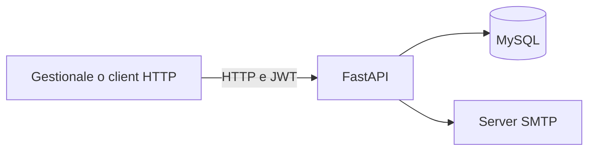

# maintenance-api

[Italiano](#italiano) · [English](#english) · [Profilo](../README.md)

## Italiano

### Problema e contributo

Ho sviluppato un backend per organizzare clienti, manutenzioni e abbonamenti nel settore impiantistico. Gli operatori registrano le scadenze e inviano promemoria ai clienti tramite il gestionale.

**Tecnologie:** Python, FastAPI, MySQL, PyMySQL, JWT, bcrypt, openpyxl e SMTP.

**Repository:** [MatteBianca/maintenance-api](https://github.com/MatteBianca/maintenance-api). Contiene documentazione e sorgenti parziali, non l'API completa avviabile. Le funzionalità e le verifiche riportate sotto si riferiscono al backend analizzato e alla copia locale preparata per il portfolio.

### Funzionalità presenti nel backend

- Creazione, consultazione, modifica ed eliminazione dei clienti.
- Manutenzioni con ricerca, scadenze, note e stato di completamento.
- Abbonamenti, registrazione manuale dei pagamenti e calcolo del rinnovo.
- Login JWT, password con bcrypt e autorizzazioni per utenti e amministratori.
- Importazione di abbonamenti da Excel e registro delle operazioni.
- Invio di promemoria email tramite endpoint HTTP, al cliente e, se configurato, all'operatore.

Il sistema aziendale prevede un avviso intorno ai 30 giorni dalla scadenza, con email oppure popup sul PC e un pulsante di invio. Il client che gestisce questo flusso non è incluso nel backend analizzato: l'API invia email quando viene chiamata e non contiene uno scheduler. I pagamenti sono registrati dall'operatore, senza addebiti online.

### Verifica e stato del progetto

Una copia locale separata è stata preparata con configurazione di esempio, schema di sviluppo e dati fittizi. In ambiente Linux sono passati 32 test automatici e 6 gruppi di prove di integrazione con MySQL e un collettore SMTP locale, senza inviare email reali. Queste prove riguardano la copia locale, non certificano l'installazione aziendale o il client Windows.

Questa scheda non include sorgenti aziendali originali, credenziali, log, backup o dati dei clienti. Prima di pubblicare ulteriori parti del software va chiarita l'autorizzazione dell'azienda.

## English

### Problem and contribution

I developed a backend to organise customers, maintenance jobs and subscriptions for an electrical installation business. Operators record due dates and send customer reminders through the business application.

**Technologies:** Python, FastAPI, MySQL, PyMySQL, JWT, bcrypt, openpyxl and SMTP.

**Repository:** [MatteBianca/maintenance-api](https://github.com/MatteBianca/maintenance-api). It contains documentation and partial source code, not the complete runnable API. The features and checks described below refer to the reviewed backend and the local copy prepared for the portfolio.

### Features implemented in the backend

- Create, read, update and delete customers.
- Maintenance jobs with search, due dates, notes and completion status.
- Subscriptions, manually recorded payments and renewal date calculations.
- JWT login, bcrypt password hashing and user/admin permissions.
- Excel subscription imports and an audit log.
- Email reminders through HTTP endpoints, sent to the customer and, when configured, the operator.

The business system provides a reminder around 30 days before a due date, with an email or a desktop popup and a send button. The client responsible for this workflow is not included in the reviewed backend: the API sends emails when called and contains no scheduler. Operators record payments; the backend does not charge customers online.

**Architecture:** HTTP client → FastAPI → MySQL and SMTP.

### Validation and project status

A separate local copy was prepared with example configuration, a development schema and fictional data. On Linux, 32 automated tests and 6 groups of integration checks passed with MySQL and a local SMTP collector, without sending real emails. These checks cover the local copy, not the company's installation or the Windows client.

This page includes no original company source code, credentials, logs, backups or customer data. Company authorisation must be clarified before publishing further parts of the software.
