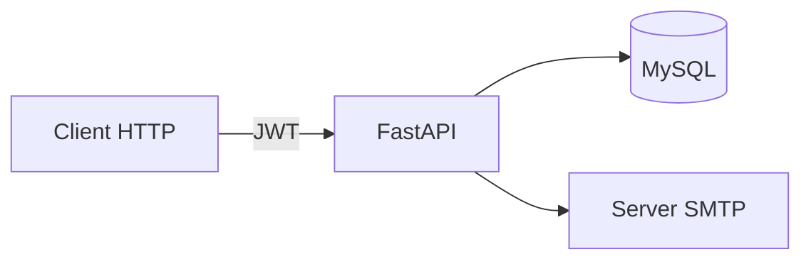

# maintenance-api

[Italiano](#italiano) · [English](#english)

## Italiano

### Problema e contributo

Ho sviluppato un backend per organizzare clienti, manutenzioni e abbonamenti nel settore impiantistico. Il progetto nasce da un'esigenza di lavoro: aiutare gli operatori a gestire scadenze e promemoria per i clienti.

Il mio contributo riguarda lo sviluppo delle API e la gestione dei dati del gestionale.

**Tecnologie:** Python, FastAPI, MySQL, JWT, bcrypt, openpyxl, SMTP.

**Stato dei sorgenti:** repository privato. Questa scheda pubblica presenta il progetto a livello generale; non richiede accesso al software aziendale.

### Ambiti del backend

- Gestione delle anagrafiche e delle scadenze di manutenzioni e abbonamenti.
- Registrazione dei pagamenti e importazione di dati da Excel.
- Accesso con autenticazione JWT e ruoli utente/amministratore.
- Invio di promemoria email e registro delle operazioni.

Gli endpoint email inviano i promemoria quando vengono chiamati dal gestionale. Il backend analizzato non include uno scheduler autonomo.

### Riservatezza

I sorgenti e i dettagli operativi restano privati. La scheda non contiene credenziali, dati dei clienti o configurazioni dell'ambiente aziendale.

[Torna al profilo](../README.md)

---

## English

### Problem and contribution

I developed a backend to organise customers, maintenance jobs and subscriptions for an electrical installation business. The project addresses a workplace need: helping operators manage due dates and customer reminders.

My contribution covers API development and data handling for the business application.

**Technologies:** Python, FastAPI, MySQL, JWT, bcrypt, openpyxl, SMTP.

**Source availability:** private repository. This public case study provides a general overview of the project without requiring access to the business application.

### Backend scope

- Customer records and due dates for maintenance jobs and subscriptions.
- Payment recording and Excel data imports.
- JWT authentication and user/administrator roles.
- Email reminders and an operation audit log.

The email endpoints send reminders when called by the business application. The reviewed backend does not include a standalone scheduler.

**Architecture:** HTTP client → FastAPI → MySQL and SMTP.

### Confidentiality

Source code and operational details remain private. This case study contains no credentials, customer data or business environment configuration.

[Back to the profile](../README_EN.md)
